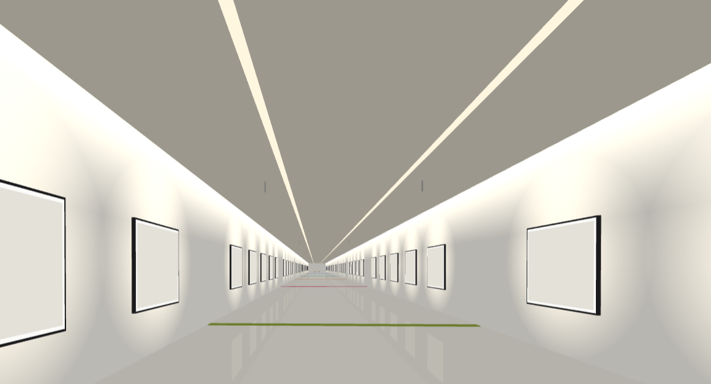
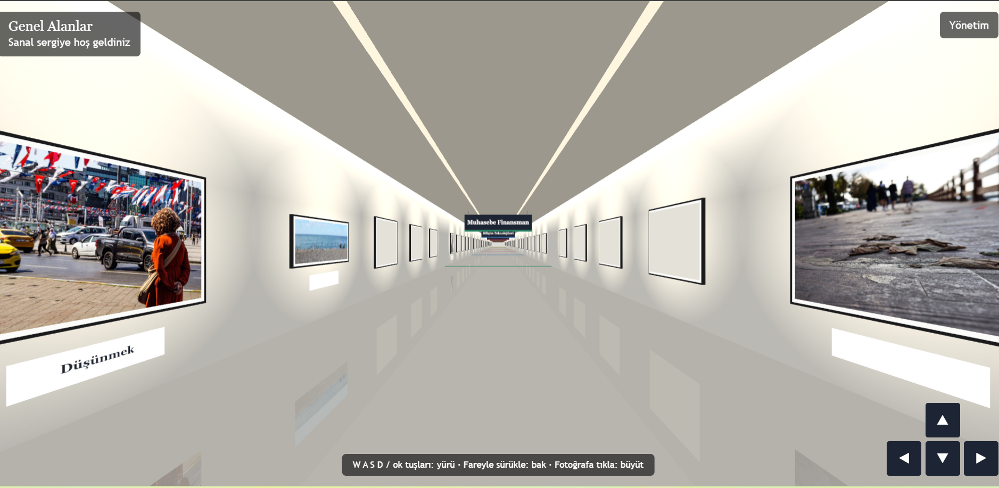
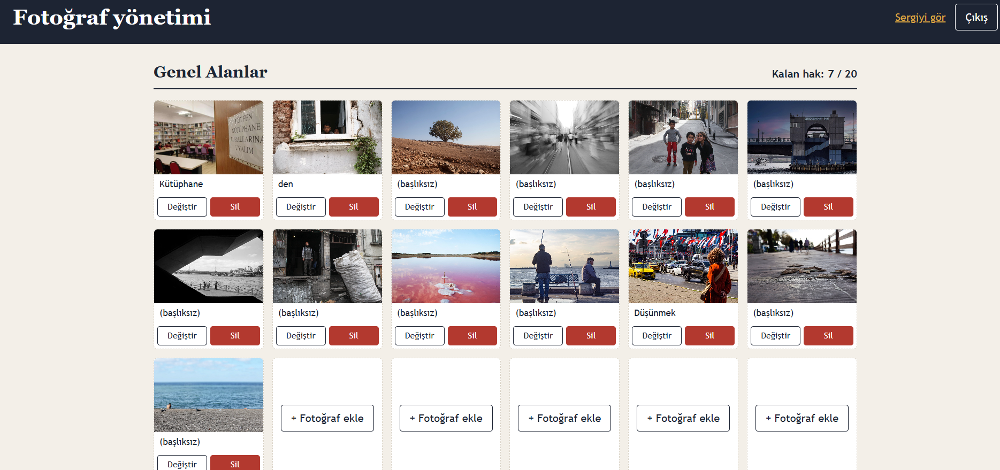

# 🏫 Okul Sanal Sergisi — 3D Fotoğraf Galerisi

**Okulların kendi fotoğraf sergilerini üç boyutlu, internetten erişilebilir bir galeride yayınlamasını sağlayan açık kaynak olarak paylaşılmaya hazır örnek web projesi.** Her okul kendi Supabase veritabanını ve yönetici hesabını kullanır; başlangıçta okul veya bölüm bilgisi girilmiş değildir.

> **Önemli:** Bu bir hazır servis hesabı değildir. Projeyi kuran okul kendi Supabase projesini oluşturur, `supabase-kurulum.sql` dosyasını çalıştırır ve `config.js` dosyasını kendi **public** bağlantı bilgileriyle düzenler. Şifreler kaynak koda eklenmez.

## ✨ Neler yapılabilir?

- Three.js ile tarayıcıdan gezilebilen 3D sergi koridoru
- Yönetim panelinden okul adı, sergi başlığı ve logo değiştirme
- Sınırsız sayıda bölüm tanımlama (bölüm başına 1–200 fotoğraf yuvası)
- Bölümlere özel renk, sıra ve fotoğraf kapasitesi ayarlama
- Fotoğraf ekleme, değiştirme ve silme; başlık ve açıklama girme
- Supabase Authentication ile yönetici girişi
- Vercel veya benzer statik site barındırma hizmetlerinde yayınlama

## 🧰 Kullanılan teknolojiler

| Teknoloji | Görevi |
| --- | --- |
| HTML / CSS / JavaScript | Web sitesi ve yönetim paneli |
| Three.js | Üç boyutlu sergi |
| Supabase PostgreSQL | Okul, bölüm ve fotoğraf kayıtları |
| Supabase Storage | Fotoğraf ve logo depolama |
| Supabase Auth | Yönetici oturumu |
| GitHub | Kaynak kod paylaşımı |
| Vercel | İnternette yayınlama |

## 🚀 Kurulum özeti

1. [Supabase hesabı oluştur](https://supabase.com) ve yeni proje aç.
2. **SQL Editor → New query** bölümünde [`supabase-kurulum.sql`](supabase-kurulum.sql) içeriğini çalıştır.
3. **Authentication → Providers → Email** üzerinden herkese açık kaydı kapat. **Authentication → Users → Add user** ile yönetici oluştur.
4. **Project URL** ve **publishable/anon public key** değerlerini `config.js` dosyasına yaz. **Secret/service_role key yazma.**
5. Bu dosyaları bir GitHub deposunun **ana dizinine** koy.
6. [Vercel](https://vercel.com/new) üzerinden GitHub deponu içe aktar: **Framework: Other**, **Build Command: boş**, **Output Directory: `.`**.
7. Yayınlanan sitenin `/admin.html` adresinden giriş yap, okul adını ve bölümleri oluştur, fotoğraflarını yükle.

Adım adım ekran ve alan açıklamaları için **[Ayrıntılı kurulum rehberini](docs/KURULUM.md)** oku.

## 📚 Konu anlatımları ve rehberler

- **[GitHub'a yükleme — sıfırdan](docs/GITHUB-YUKLEME.md)**: Depo açma, dosya yükleme, güncelleme
- **[Supabase + Vercel kurulumu](docs/KURULUM.md)**: Veritabanı, Storage, kullanıcı, yapılandırma, yayınlama
- **[Yönetim paneli kullanım kılavuzu](docs/KULLANIM.md)**: Okul tabelası, bölüm yönetimi, fotoğraf yükleme
- **[Sistem nasıl çalışır?](docs/KONU-ANLATIMI.md)**: Frontend, veritabanı, Auth, RLS ve 3D galeri ilişkisi
- **[Güvenlik ve sorun giderme](docs/GUVENLIK-SSS.md)**

## 📂 Dosyalar

```text
okul-sergi/
├── index.html             # Ziyaretçilerin gördüğü sergi
├── admin.html             # Yönetim paneli
├── style.css              # Tasarım
├── gallery.js             # 3D sergi motoru
├── admin.js               # Bölüm / fotoğraf yönetimi
├── api.js                 # Supabase sorguları
├── config.js              # Her okulun kendi PUBLIC bağlantı ayarları
├── supabase-kurulum.sql   # Yeni Supabase için tablolar ve politikalar
├── .gitignore
├── README.md
└── docs/                  # Türkçe konu anlatımı ve rehberler
```

## 🔐 Güvenlik uyarısı

Bu depoda **gerçek kullanıcı adı, şifre, okul logosu ve kişisel veritabanı bağlantısı bulunmaz**. `config.js` içine yalnızca istemci tarafında paylaşılabilir Supabase URL ve publishable/anon anahtarı yazılır. Verilere erişimi **RLS politikaları** sınırlar. Bu örnek SQL'de, projede giriş yapabilen **her authenticated kullanıcı yazma yetkisine sahiptir**; bu nedenle genel kayıt kesinlikle kapalı tutulmalı, yalnızca güvenilen yönetici hesapları açılmalıdır. Daha ayrıntılı kurumsal yetkilendirme için rol bazlı politikalar gerekir.

Öğrenci fotoğraflarını paylaşmadan önce gerekli izinleri/aydınlatma süreçlerini okulunuzun mevzuatına göre değerlendirin. Fotoğraflar ve okul logosu herkese açık görüntülenir.

## ⚠️ Bilinen sınırlar

- Tarayıcının WebGL desteği gerekir. Bazı cihazlarda veya devre dışı WebGL ayarlarında galeri açılmaz.
- Proje statiktir; doğrudan `file://` üzerinden değil yerel web sunucusu veya Vercel gibi bir sunucuda açılmalıdır.
- Bu SQL **yeni Supabase projesi** için hazırlanmıştır; mevcut veritabanında doğrudan çalıştırılmamalıdır.
- Her bölüm için fotoğraf limiti 200'dür. Çok sayıda bölüm/fotoğraf 3D performansını etkileyebilir.
- Kod için otomatik uçtan uca testler içerilmemektedir; yayına almadan önce kendi Supabase hesabınızla test edin.

## 📄 Lisans

Henüz bir açık kaynak lisansı eklenmemiştir. Projeyi açık kaynak lisansı altında yayımlamak istiyorsanız deponuza ayrıca uygun bir `LICENSE` dosyası ekleyin.
